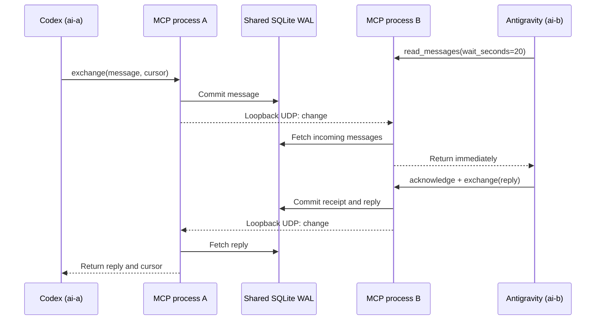

# Design and limits

## Fast path

SQLite is the source of truth. Sends are committed before a best-effort datagram
is emitted to each registered local MCP process. The packet is just `change`;
message text never travels over UDP. Receivers wake all local async waiters, then
read SQLite. The event is captured before querying to avoid missed-wakeup races.

Each process listens on a dynamically assigned `127.0.0.1` UDP port. Ports are
recorded in the shared database, refreshed every five minutes, and removed on
normal shutdown. Stale listener registrations expire after one hour. No fixed
port, central broker, external package, background service, or internet is needed.
Run both agents in the same OS/network environment; isolated containers and
machines are outside this design.

If sockets are unavailable or datagrams are dropped, waiting calls recheck at
most every two seconds. Normal delivery does not wait for this timer. Resource
monitoring runs only while subscribed; an idle, unsubscribed process performs no
inbox polling. SQLite indexes cover recipient, thread, unread messages, and retry
tokens. Queries are paginated. Connections close deterministically after each
transaction, including on Windows.

## Reliability

- `client_token` provides durable deduplication per sender. Same key and same
  payload returns the original message; changed payload fails. Check and insert
  share a transaction. Omit the token to deliberately allow duplicates.
- Incoming reads never delete or acknowledge. A crash before handling a message
  leaves it available for replay. Save your cursor only after you can recover the
  work. Acknowledge only messages you actually processed.
- Read receipts are per-message. `latest_sent_message_acknowledged` is the highest
  acknowledged sent ID; it does **not** imply all lower IDs were acknowledged.
  `sent_acknowledged_count` also changes when an older message is acknowledged
  out of order, so subscribers and activity waiters can detect that receipt.
  Use `conversation` to inspect individual `read_at` values.
- Reply links reference an incoming message and inherit its thread when omitted.
  A conflicting explicit thread is rejected. An empty filter means all threads;
  keep independent cursors for different filters and for conversation history.
- `exchange` reduces model/tool round trips. It sends first and reads the inbox
  after the supplied cursor; it does not guarantee the returned message is a
  direct reply. Use `reply_to` to correlate responses. Cancellation stops the
  wait but does not roll back the committed send.
- Expiring status avoids indefinitely stale “typing” indicators. It is explicitly
  advertised by an agent; it is not an online test or model-token stream.
- MCP cancellation frees pending waits; stdin EOF cancels active requests and
  shuts down without waiting for the full inbox timeout.

## MCP surface

Newline-delimited JSON-RPC over stdio; logs never go to stdout. The server
implements initialization, ping, tools, resources/read/list/subscribe/unsubscribe,
resource update notifications, and cancellation. It negotiates the supported
2024-11-05, 2025-03-26, 2025-06-18, or 2025-11-25 MCP revision. It does not advertise
sampling, prompts, task execution, HTTP, or other unimplemented capabilities.
This is a small focused implementation, not a general MCP SDK replacement.

Inputs are type checked and bounded, waits are limited to 30 seconds, and up to
64 concurrent requests are accepted. MCP hosts may choose whether to subscribe
to resources or act on notifications. The integration tests simulate a subscribing
host; they do not prove either commercial client automatically starts model turns.

## Trust and scope

Two identities, one shared local conversation database. Identity is assigned by
process configuration, not tool arguments. Anyone able to change the command or
read/write the database is trusted. This is not multi-user authentication, a
remote chat service, or a sandbox for hostile agents. Message bodies are plain
untrusted conversation; the server never executes them. WAL databases and message
history stay out of Git. Separate experiments can use separate `--db` files.

## Verification

`python test_messenger.py` starts real MCP subprocesses using temporary databases.
It checks bidirectional exchange, migration, persistence, threads, receipts,
deduplication, validation, paging, notification delivery, cancellation, socket-free
fallback, and clean EOF shutdown. A 20-message test reports observed latency.
Results measure local transport plus database work, not model inference time.

References: [resources](https://modelcontextprotocol.io/specification/2025-11-25/server/resources),
[cancellation](https://modelcontextprotocol.io/specification/2025-11-25/basic/utilities/cancellation).
